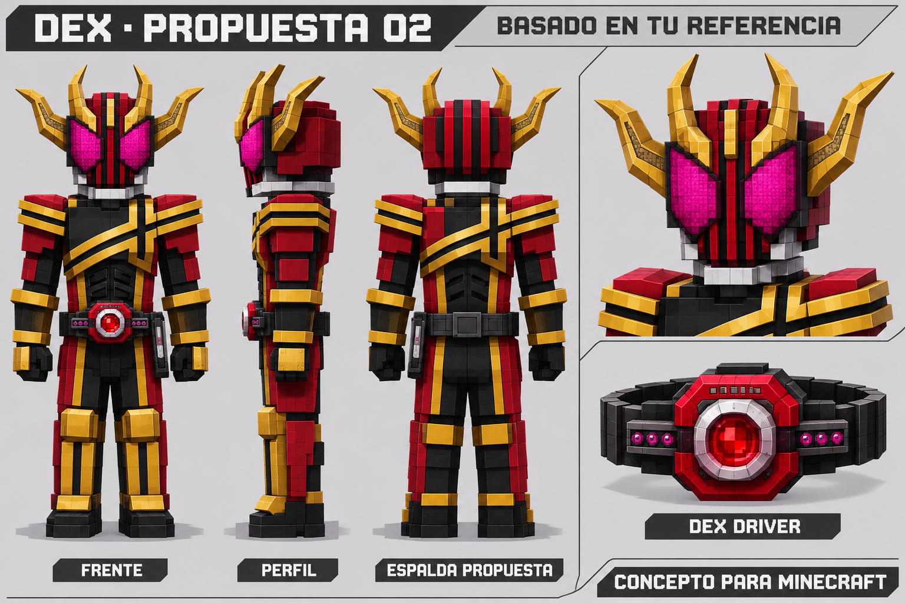

# Dex / Yusuke — ficha de diseño 02

Estado de desarrollo: [modelo implementado, recursos y vistas de la geometría](IMPLEMENTACION.md).

Etapa 1: definición visual del traje completo y del Dex Driver. Referencia principal: la imagen aportada por el autor durante esta conversación. La lámina es una propuesta conceptual para adaptar esa referencia a Minecraft; todavía no es un modelo exportado ni una captura del juego.

[Imagen de referencia del autor](referencia-autor.png) · [Prompt de la lámina](prompt-concepto-02.txt)

Dex se inspira en Decade y su dispositivo de transformación toma como base conceptual un Driver tipo Neo Decadriver. Su apariencia sigue el diseño de la imagen del autor: casco rojo y negro, cuatro cuernos dorados curvos, ojos magenta, bandas doradas diagonales sobre el pecho negro y un Driver con núcleo circular rojo.

El alcance de esta ficha es **Dex Form base: traje completo, casco, visor y Driver**. El estuche de cartas visible en la cadera se integra en la silueta. La espalda y la parte inferior de las piernas se completan como propuestas, porque la referencia no las muestra de forma suficiente.

| Pieza | Dirección de diseño para el modelo |
| --- | --- |
| Casco | Carcasa roja, franjas y relieves negros verticales desde la coronilla hacia el centro de la cara. Mandíbula inferior plateada y collar claro. Adaptar el volumen a la cabeza de Minecraft con placas escalonadas. |
| Cuernos | Cuatro cuernos dorados: dos interiores altos junto a la frente y dos exteriores que se abren hacia los lados y suben. Construir la curva mediante varios segmentos rotados que disminuyen de grosor. |
| Ojos | Dos lentes grandes magenta, alargadas y orientadas hacia afuera, con borde oscuro y textura de facetas o puntos. La superficie de la lente se ve continua; las franjas negras verticales pertenecen al casco. |
| Pecho | Panel negro con las bandas doradas diagonales y la unión vertical desplazada que aparecen en la referencia. Dar grosor a las bandas. Su colocación asimétrica es parte del diseño. |
| Abdomen y costados | Abdomen negro segmentado; placas rojas laterales con bordes dorados. Dejar lectura clara entre pecho, abdomen y cinturón. |
| Hombros | Placas rojas con dos bandas doradas separadas por una franja oscura. Ajustar el tamaño para que los brazos puedan levantar el arma sin atravesar las hombreras. |
| Brazos y manos | Paneles rojos en la parte superior, articulaciones negras, antebrazos negros con protecciones y aros dorados, guantes negros y protección dorada en el dorso. |
| Cadera y muslos | Paneles rojos exteriores con cantos dorados, zona interior negra y elementos dorados frontales siguiendo la referencia. Estuche rectangular de cartas en la cadera izquierda del personaje. |
| Rodillas, espinillas y botas | Propuesta: rodilleras doradas, placas doradas frontales separadas por una franja negra, paneles rojos exteriores y suelas negras. Ajustar estos volúmenes al movimiento de la pierna. |
| Espalda | Propuesta: centro negro, placas rojas en la zona de los omóplatos y continuación de las bandas doradas. El dibujo posterior de la lámina sirve como propuesta de colocación. |
| Dex Driver | Correa negra y cuerpo horizontal negro/rojo. Lente roja circular prominente, aro plateado y carcasa roja alrededor; pequeños indicadores magenta a los lados. En Minecraft, resolver el círculo con una silueta octogonal y relieve escalonado. |

La paleta de trabajo es rojo profundo, negro carbón, dorado cálido, magenta en los ojos, plata en mandíbula/collar/aro del Driver y rojo luminoso en su lente. El brillo se concentra en los ojos y el dispositivo. Los tonos definitivos se ajustarán en las texturas; la iluminación de la referencia y de la lámina no define por sí sola sus valores RGB.

La ranura superior para insertar cartas del Driver es una interpretación funcional para la adaptación. La imagen de referencia no permite comprobar su mecanismo completo. La ficha define su apariencia; la animación mecánica se concretará al preparar el modelo.

La traducción al mod debe mantener proporciones compatibles con su esqueleto: cabeza cúbica, torso y extremidades rectos, articulaciones con espacio para las poses. Los cantos suaves y cuernos afinados de la lámina se resolverán con cubos, segmentos rotados y sombreado de textura. La lámina no determina coordenadas exactas, UV ni cantidad final de cubos.

Los cambios técnicos previstos a partir de esta dirección visual son:

| Sistema actual | Trabajo previsto durante la implementación |
| --- | --- |
| Ojos verdes y franjas horizontales de la base | Preparar lentes magenta continuas como apariencia predeterminada del diseño nuevo; mantener disponibles las opciones del editor y respetar las elecciones guardadas del jugador. |
| Cuernos seleccionables | Adaptar la variante curva a la referencia y revisar cómo encajan las otras opciones en el nuevo casco. |
| X del pecho actual | Modelar las bandas diagonales con la colocación asimétrica de la imagen de referencia. |
| Driver incorporado al traje | Cambiar su cuerpo y lente al diseño circular rojo con aro plateado. |
| Driver en la ranura de Curios | Actualizar su geometría para que represente el mismo dispositivo con relieve. Actualmente usa una placa frontal y una correa. |
| Driver como objeto | Preparar una representación coherente del dispositivo en mano e inventario. Actualmente el modelo de objeto utiliza un sprite generado. |
| Personalización | Distribuir las nuevas UV entre las capas de color correspondientes, conservar las máscaras de brillo y comprobar los acabados. |
| Form Ride y Emotion | Revisar los estados que reutilizan la geometría base, sus colores, accesorios y efectos visuales. |

Los archivos principales que habrá que intervenir o consultar son:

| Función | Ruta desde la raíz del proyecto |
| --- | --- |
| Geometría base | `src/main/resources/assets/dexrider/geckolib/models/item/armor/dex_armor.geo.json` |
| Textura base y capas | `src/main/resources/assets/dexrider/textures/item/armor/dex_armor*.png` |
| Colores de fábrica y herencia de estados | `src/main/java/com/draxer/dexrider/item/SuitLooks.java` |
| Opciones de piezas del editor | `src/main/java/com/draxer/dexrider/item/SuitLook.java` |
| Selección de piezas y capas al dibujar | `src/main/java/com/draxer/dexrider/client/DexArmorRenderer.java` |
| Geometría del cinturón de Curios | `src/main/java/com/draxer/dexrider/client/DexDriverBeltModel.java` |
| Renderizado del cinturón | `src/main/java/com/draxer/dexrider/client/DexDriverCurioRenderer.java` |
| Textura del cinturón | `src/main/resources/assets/dexrider/textures/entity/dex_driver_belt.png` |
| Modelo y definición del objeto Driver | `src/main/resources/assets/dexrider/models/item/dex_driver.json` y `src/main/resources/assets/dexrider/items/dex_driver.json` |
| Textura del objeto Driver | `src/main/resources/assets/dexrider/textures/item/dex_driver.png` |
| Generador de piezas complementarias | `tools/suit_parts.py` |

Los huesos y pivotes empleados por las animaciones y el renderer se conservan como base de integración. Los modelos especializados de Upgrade y Complete usan recursos propios: se debe inventariar dónde incorporan el Driver al trasladar su nueva apariencia a esas formas. La definición visual aquí corresponde a la forma base.

El resultado modelado se comprobará con estos criterios:

1. Dex se reconoce por los ojos magenta, los cuatro cuernos curvos, las bandas del pecho y el Driver circular incluso a distancia de juego.
2. El casco mantiene separados los dos ojos y las cuatro puntas en frente, perfil y tres cuartos.
3. El mismo Driver aparece de forma coherente en la armadura, en el cinturón y como objeto.
4. Los hombros, cuernos, cintura y piernas permiten caminar, agacharse y ejecutar las poses de combate sin intersecciones evidentes.
5. Las capas de color, el brillo y las piezas seleccionables responden al editor y se revisan en los estados compartidos.
6. La espalda y las botas se presentan como decisiones de adaptación revisables, en lugar de atribuirlas a una parte de la referencia que no se ve.

La imagen `concepto-02.png` se generó con la herramienta integrada imagegen usando únicamente la imagen del autor como referencia visual. Se conserva el prompt completo en `prompt-concepto-02.txt`. En esta etapa se han preparado la ficha y la lámina conceptual; la implementación de geometría, texturas y código es la siguiente etapa.
