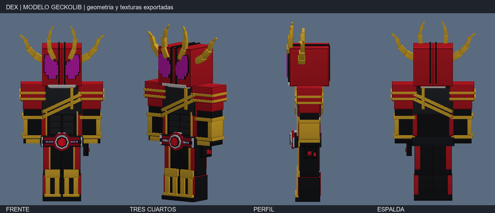
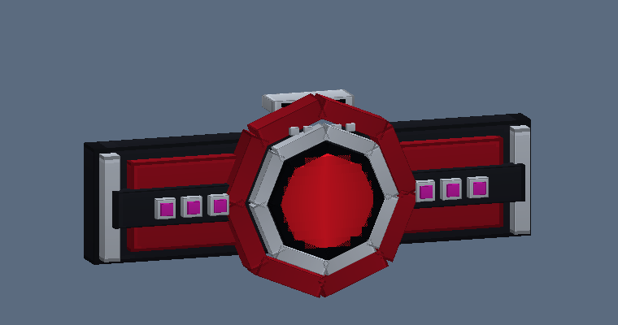

# Dex — modelo basado en la referencia

Se implementó la forma base completa a partir de la [ficha de diseño](FICHA_DEX.md) y de la [referencia del autor](referencia-autor.png). Las imágenes siguientes se renderizan desde la geometría y las texturas exportadas; son vistas del recurso del mod fuera del juego.





El traje tiene lentes magenta, cuatro cuernos curvos segmentados, relieves negros verticales en el casco, mandíbula y collar plateados, bandas doradas diagonales sobre el pecho, hombros con dos bandas, placas de brazos y piernas y un Driver circular con lente roja y aro plateado. La espalda y las botas desarrollan las propuestas de la ficha.

El modelo mantiene los 47 huesos originales y sus relaciones. Las piezas opcionales del editor y los accesorios de las Form Ride siguen formando parte del recurso. El generador conserva las zonas de UV antiguas de esos accesorios y reserva una región nueva para el traje. Las capas permiten teñir los segmentos y separar los dos lados de Half-Cold Half-Hot.

El nuevo aspecto de fábrica se define en `SuitLooks.java`: magenta, cuernos curvos y lentes continuas. Los valores explícitos de un diseño guardado se aplican después. La conversión del formato antiguo `SuitConfig` conserva sus valores originales. Upgrade conserva su color de ojos de fábrica; su traje especializado pertenece a otro modelo.

El Driver de la forma base, el cinturón de Curios y el objeto tridimensional se generan desde la misma lista de 60 piezas. La lente y los indicadores del Driver incorporado a la armadura tienen una capa de brillo propia de color fijo. Las formas especializadas Upgrade y Complete conservan sus modelos existentes.

La fuente de geometría y materiales es [tools/dex_reference_model.py](../../tools/dex_reference_model.py). Los archivos exportados principales son:

- [Armadura GeckoLib](../../src/main/resources/assets/dexrider/geckolib/models/item/armor/dex_armor.geo.json).
- [Modelo del objeto Driver](../../src/main/resources/assets/dexrider/models/item/dex_driver.json).
- [Modelo del cinturón de Curios](../../src/main/java/com/draxer/dexrider/client/DexDriverBeltModel.java).
- Las capas `dex_armor*.png` de `src/main/resources/assets/dexrider/textures/item/armor/`.
- `src/main/resources/assets/dexrider/textures/item/dex_driver_3d.png` y `textures/entity/dex_driver_belt.png`.

La [copia de recursos y fuentes originales](respaldo-0.56.0.zip) sirve de base al generador. Debe conservarse junto con él. Para reproducir la exportación y las vistas, desde la raíz del proyecto, con Pillow y NumPy disponibles:

```powershell
python tools/dex_reference_model.py --preview
```

Para comprobar los recursos sin regenerarlos:

```powershell
python tools/dex_reference_model.py --check-only
```

El generador es la fuente de las piezas nuevas. Una edición manual de sus salidas se perdería al volver a ejecutarlo. Los accesorios que conserva provienen del archivo original; si se cambia su fuente, hay que incorporar ese cambio al proceso de generación. `tools/suit_parts.py` también actualiza la región de las lentes nuevas cuando regenera las variantes del visor.

Las comprobaciones de recursos cubren nombres y parentesco de los huesos, dimensiones positivas, UV dentro de la textura, tamaños de las capas, separación de los colores de Half-Cold Half-Hot, correspondencia entre lentes y líneas para cada visor y las rotaciones permitidas del objeto Driver. Se revisaron visualmente las vistas frontal, tres cuartos, perfil, espalda y el detalle del Driver.

Compilación y empaquetado verificados el 17 de noviembre de 2026 con Java 25: `gradlew.bat compileJava processResources jar --offline --console=plain`, resultado `BUILD SUCCESSFUL`. El paquete se encuentra en `build/libs/`. Las comprobaciones del generador pasan con 47 huesos, 326 cuboides y 60 piezas del Driver.

La comprobación dentro de Minecraft deberá revisar las poses en movimiento, posibles cruces entre piezas, aspecto del objeto en mano/inventario y cambios de forma. Estas vistas externas no acreditan esa comprobación.
