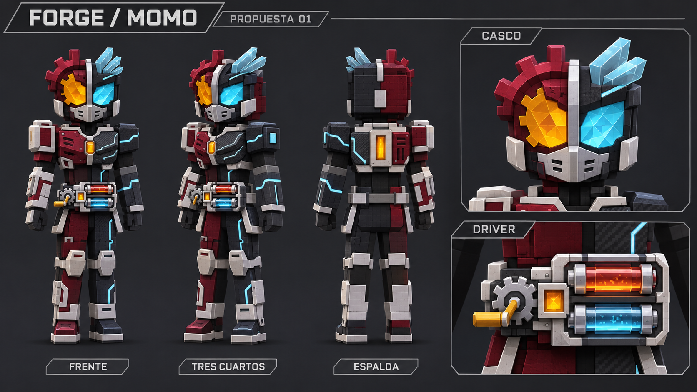

# Forge / Momo — propuesta 01

**Esta propuesta fue sustituida por petición del autor. Dirección vigente: [apariencia de Build RabbitTank, propuesta 02](FICHA_FORGE_02.md).** El contenido siguiente se conserva como historial de la primera propuesta.

Traje completo y Driver propios, inspirados en la combinación de dos mitades de Build. Se parte del modelo actual y de `ForgeForms.java`. La lámina es arte conceptual generado con imagegen integrado; no es una exportación de geometría ni una captura del juego.

[Prompt exacto](prompt-concepto-01.txt) · [Geometría actual renderizada](modelo-actual.png)

## Forma base: Engranaje + Carbono

La derecha del personaje (izquierda al mirarlo de frente) es la mitad herramienta: rojo oscuro, geometría mecánica y lente ámbar. La izquierda es la mitad materia: grafito, textura de carbono y detalles azul hielo. Las placas blancas y plateadas unen visualmente ambas mitades.

- Casco: cresta de dientes de engranaje sobre la lente derecha, aletas facetadas cortas sobre la izquierda; visores amplios y diferentes, separador central plateado y mandíbula con pequeñas ventilaciones.
- Torso: peto asimétrico con placa industrial roja y panel de carbono, pequeño punto de unión ámbar y abdomen flexible oscuro.
- Brazos: placas desmontables claras en hombro y antebrazo derechos; circuitos azules finos en el izquierdo. Guantes cerrados.
- Piernas: continuidad de ambas mitades, rodillas y guardas claras, botas prácticas sin tacón.
- Espalda: panel central con núcleo ámbar y dos placas laterales que mantienen correctamente la orientación de los colores.
- Driver: dos cápsulas horizontales superpuestas, roja/ámbar arriba y azul abajo; carcasa clara, ventana de mezcla ámbar y engranaje con manivela corta a la derecha del personaje. Es el cinturón de Forge; el objeto Module Driver pertenece a Proto.

## Variantes existentes que debe cubrir la implementación

| Mitad derecha / izquierda | Carbono | Magnesio | Fibra |
| --- | --- | --- | --- |
| Engranaje | Base, en sintonía | Gear + Magnesium | Gear + Fiber |
| Cañón | Cannon + Carbon | Flare, en sintonía | Cannon + Fiber |
| Escudo | Shield + Carbon | Shield + Magnesium | Bastion, en sintonía |

Son nueve combinaciones. Momo NPC utiliza estas formas; Kamen Ride: Forge del jugador usa la base. La implementación debe conservar esta conducta, las piezas de cada herramienta y los colores de cada materia. El código define rojo/orange/azul para herramienta y azul hielo/crema/verde para las señales de materia; la base conserva el panel grafito de su modelo actual.

Las formas deben compartir casco y torso modulares, separando las piezas por mitad para que Cañón, Escudo, Magnesio y Fibra sean reconocibles por su geometría además del color. La lámina solo define la base; los detalles de las otras combinaciones aún requieren adaptación.

## Archivos y siguiente etapa

Recursos: `src/main/resources/assets/dexrider/geckolib/models/item/armor/rider_forge*.geo.json` y `textures/item/armor/rider_forge*.png`, incluidas máscaras de brillo. `tools/rider_relief.py` también genera piezas: la nueva geometría deberá coordinarse con él. Lógica de formas: `src/main/java/com/draxer/dexrider/rider/ForgeForms.java`.

El siguiente paso es modelar, ajustar UV y brillo, propagar a las nueve combinaciones, revisar vistas reales y compilar para Minecraft **26.2**. Se debe conservar la corrección del Ride Booker de 0.56.1+26.2. Esta etapa conceptual no cambia los recursos de juego ni el paquete compilado.
