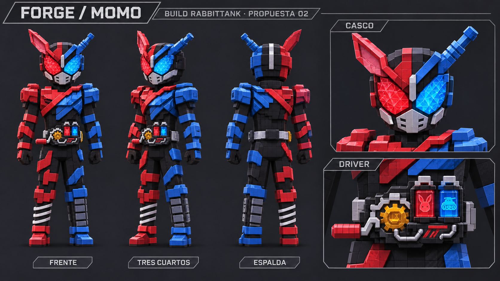

# Forge / Momo — apariencia Build RabbitTank

Dirección vigente solicitada por el autor: usar la apariencia de Build para Forge. Esta propuesta toma RabbitTank como base, conservando la identidad Forge/Momo.

[Prompt exacto](prompt-concepto-02.txt) · [Propuesta anterior](FICHA_FORGE_01.md)

La lámina fue creada con imagegen integrado. Es arte conceptual adaptado a bloques, todavía no geometría GeckoLib exportada ni una captura del juego.

- Casco negro, lentes roja y azul, rasgos de conejo y tanque, mandíbula plateada.
- Peto rojo y azul con división diagonal; placas y detalles de resorte y oruga sobre traje negro.
- Build Driver con mecanismo ámbar, dos botellas verticales contiguas y manivela. Sustituye las cápsulas horizontales de la propuesta anterior.
- Vistas frontal, tres cuartos y espalda, con detalles de casco y cinturón.

La geometría final deberá cotejar la distribución de colores y piezas entre las vistas; la ilustración generada no es un plano exacto de cada pieza.

La implementación se compilará para Minecraft **26.2**, conservando la corrección del Ride Booker de 0.56.1+26.2. Esta decisión cambia la apariencia base, sin introducir automáticamente las habilidades ni las formas canónicas de Build.

Forge tiene nueve combinaciones existentes: herramienta (Engranaje, Cañón, Escudo) y materia (Carbono, Magnesio, Fibra). La adaptación visual de las otras ocho queda pendiente, manteniendo su lógica actual. Las utiliza Momo NPC; el jugador usa la base.

Siguiente etapa: geometría real, UV y brillo, variantes, vistas exportadas y compilación. Los recursos de juego y el JAR aún no cambian en esta etapa conceptual.
