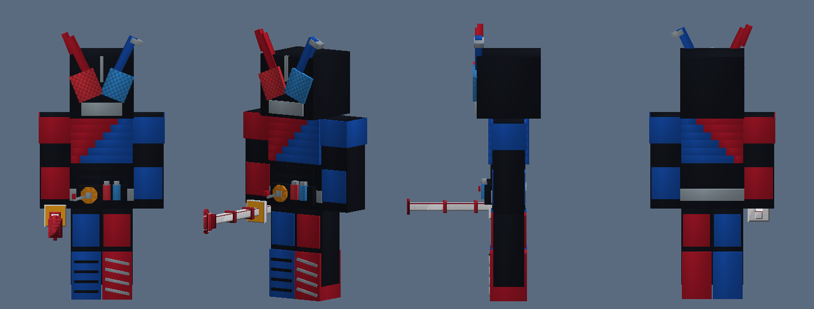

# Forge / Momo — apariencia Build RabbitTank

Dirección vigente solicitada por el autor: usar la apariencia de Build para Forge. Esta propuesta toma RabbitTank como base, conservando la identidad Forge/Momo.

[Prompt exacto](prompt-concepto-02.txt) · [Propuesta anterior](FICHA_FORGE_01.md)

La lámina fue creada con imagegen integrado. Es arte conceptual adaptado a bloques, todavía no geometría GeckoLib exportada ni una captura del juego.

- Casco negro, lentes roja y azul, rasgos de conejo y tanque, mandíbula plateada.
- Peto rojo y azul con división diagonal; placas y detalles de resorte y oruga sobre traje negro.
- Build Driver con mecanismo ámbar, dos botellas verticales contiguas y manivela. Sustituye las cápsulas horizontales de la propuesta anterior.
- Vistas frontal, tres cuartos y espalda, con detalles de casco y cinturón.

El modelo de GeckoLib está implementado en las nueve combinaciones de Forge para Minecraft 26.2. El jugador usa la base roja y azul. Momo combina las tres herramientas con los tres materiales.

