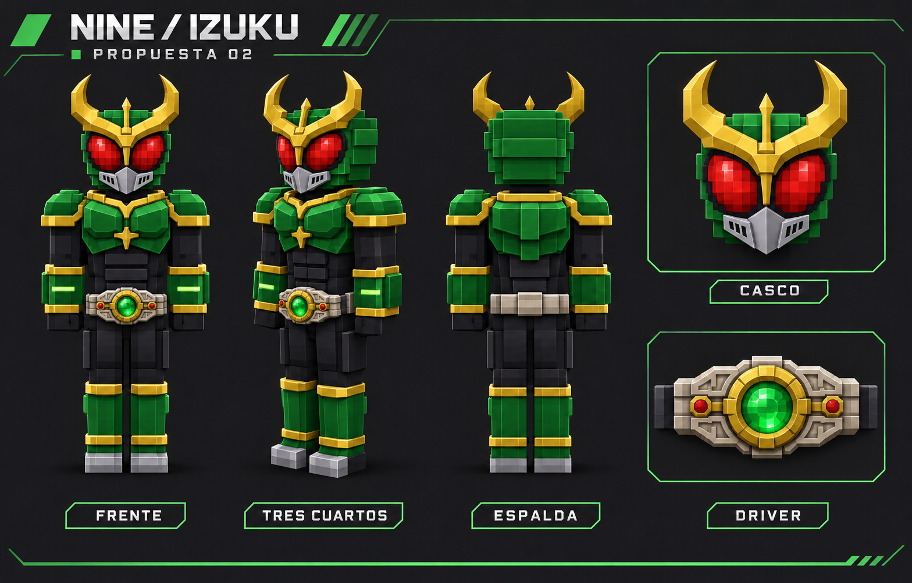

# Nine / Izuku — propuesta 02

Estado posterior: [geometría implementada y variantes](IMPLEMENTACION.md). La lámina siguiente sigue siendo conceptual.

Dirección solicitada por el autor: acercar Nine más a Kuuga. Esta lámina propone el traje completo y el Driver, manteniendo el verde de Izuku como interpretación de partida. Es arte conceptual generado con la herramienta integrada imagegen; todavía no es geometría exportada ni una captura del juego.

[Prompt exacto de la revisión](prompt-concepto-02.txt) · [Prompt inicial](prompt-concepto-01.txt) · [Modelo actual renderizado desde los recursos](modelo-actual.png)

## Diseño

- Casco: verde, cresta frontal dorada ancha con dos puntas curvas y pequeño remate central. Desaparecen las antenas laterales escalonadas del modelo anterior.
- Visor: dos lentes rojas amplias y facetadas, con borde negro. Mandíbula plateada con pequeñas aberturas oscuras.
- Torso: dos grandes placas pectorales verdes de aspecto orgánico, borde dorado en el cuello y pequeño motivo central propio. Abdomen negro segmentado.
- Extremidades: hombreras verdes compactas, antebrazos y espinillas verdes con bandas doradas; guantes, muslos y articulaciones negros. Dos detalles de luz verde pálido en antebrazos.
- Espalda: placas verdes unidas visualmente al peto, con espacio negro libre en cintura y articulaciones.
- Driver: carcasa clara de aspecto pétreo, aro dorado, gema central circular verde y dos nodos rojos laterales. Sustituye la piedra en rombo y las cuatro garras del recurso actual. Los grabados son geométricos propios.

## Integración prevista

El juego usa `src/main/resources/assets/dexrider/geckolib/models/item/armor/rider_nine.geo.json` y las texturas `rider_nine.png` / `rider_nine_glowmask.png`. `tools/rider_relief.py` también genera piezas de Nine: la implementación debe coordinarse con ese generador para evitar sobrescrituras.

Hay ocho modelos: base, Dragon, Pegasus y Titan, más la versión Rising de cada uno. `NineForms.java` define base verde, Dragon azul, Pegasus plateado y Titan morado. Rising incorpora acentos dorados. Como la propuesta base ya contiene dorado, Rising necesitará distinguirse por mayor cobertura dorada y un patrón luminoso adicional; ese detalle aún no está modelado.

Las formas avanzadas pertenecen al NPC Izuku; el jugador con Kamen Ride: Nine utiliza la forma base. La implementación visual debe conservar esa conducta y las piezas específicas de cada variante.

La adaptación deberá mantener los huesos del modelo, revisar UV y brillo, exportar vistas reales y comprobar el jugador y el NPC. Los recursos de juego de Nine y el JAR de Dex no se han cambiado en esta etapa conceptual.
