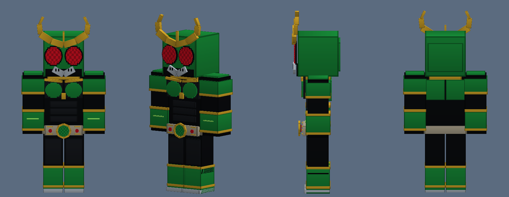

# Nine: adaptación del concepto 02

Compilado y empaquetado para Minecraft **26.2** en `build/libs/dexrider-0.56.0+26.2.jar`, junto con el Dex rediseñado. Las 40 pruebas de servidor del proyecto pasaron el 17 de noviembre de 2026. Esto valida la carga y la lógica cubierta por esas pruebas; la apariencia en el cliente sigue pendiente de revisión.

El generador `tools/nine_reference_model.py` exporta la forma base y las siete variantes del recurso existente. Conserva nombres, parentesco y pivotes de los huesos, así como las armas de Dragon, Pegasus y Titan. Los cubos antiguos del cuerpo y los relieves se sustituyen; las texturas de las armas se conservan en su región original.

El Driver circular está integrado en el torso. La cresta dorada, las lentes rojas, la mandíbula plateada, las placas verdes y el cinturón siguen la propuesta 02. Cada forma mantiene su color; Rising añade bandas doradas y detalles luminosos. No se cambian poderes ni selección de formas.

Las texturas pasan a 512 × 1024; las piezas nuevas usan una región reservada, con máscara de brillo para ojos, gema e indicadores. `recursos-originales.zip` contiene la fuente original del generador y debe conservarse. `tools/rider_relief.py` deja Nine a cargo del nuevo generador para evitar mezclar ambos diseños.

Para regenerar recursos y vistas: `python tools/nine_reference_model.py --preview` (Pillow y NumPy). Estas vistas se obtienen de los recursos exportados, fuera del juego. Quedan por comprobar las animaciones, armas y cambios de forma dentro de Minecraft 26.2.
